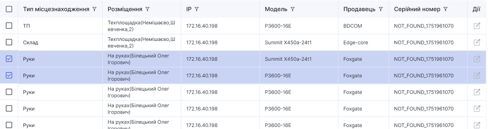
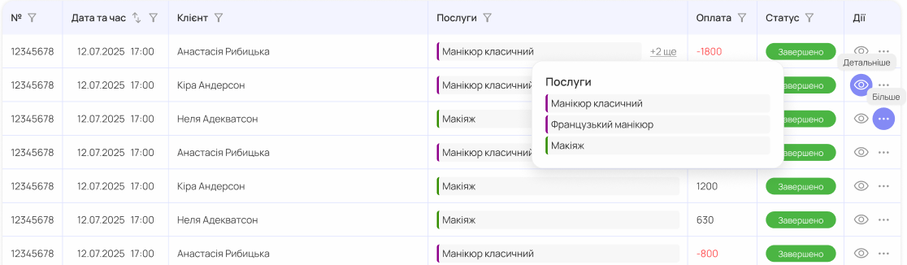

# NgxDataGridx Component Documentation

## Overview




**NgxDataGridx** is an Angular component that renders data in a highly customizable and interactive data table. It supports features such as filtering, sorting, pagination, CSV export, expandable sub-grids, and integration with Angular Material components.

🔗 **GitHub Repository**: [Trixwell/data-grid](https://github.com/Trixwell/data-grid)
---

## Installation

To use `NgxDataGridx`, ensure you have Angular and Angular Material installed. Then, import the component into your module:

```bash
npm install ngx-data-gridx
```

### Required peer dependencies:

```bash
npm install @angular/material @angular/forms @angular/common rxjs
```

**In your `app.module.ts`:**

```ts
import { NgxDataGridx } from 'ngx-data-gridx';

@NgModule({
  declarations: [AppComponent],
  imports: [NgxDataGridx],
  bootstrap: [AppComponent],
})
export class AppModule {}
```

---

## Inputs (`@Input`)

| Name                 | Type                                          | Description                                            |
| -------------------- | --------------------------------------------- |--------------------------------------------------------|
| `url`                | `string`                                      | API endpoint to load data from.                        |
| `exportCsvUrl`       | `string`                                      | URL to export the current filtered data in CSV format. |
| `data`               | `GridProperty[]`                              | Configuration for grid columns.                        |
| `limit`              | `number`                                      | Number of rows per page.                               |
| `listKey`            | `string`                                      | Response key holding the rows (default `list`).        |
| `totalsUrl`          | `string \| null`                              | Optional endpoint returning `{ response: { totals } }`; overrides totals from the list response. |
| `sort`               | `string`                                      | Sort direction: `asc` or `desc`.                       |
| `sidx`               | `string`                                      | Field name to sort by.                                 |
| `grid_name`          | `string`                                      | Unique identifier for the grid.                        |
| `multiselect`        | `boolean`                                     | Enables row multi-selection.                           |
| `showFilters`        | `boolean`                                     | Toggle filter visibility.                              |
| `subUrlParams`       | `{ paramName: string; columnName: string }[]` | Parameters to pass to sub-grid requests.               |
| `currentRow`         | `object`                                      | Parent row context for sub-grid data.                  |
| `showHistoryFilters` | `boolean`                                     | Display history of applied filters.                    |
| `expandedElement`    | `object`                                      | Row currently expanded to show sub-grid.               |
| `expandableAll`      | `boolean`                                     | Allow several open sub-grids (default: one at a time). |
| `noDataPlaceholder`  | `string`                                      | Message to display when no data is found.              |
| `parentGridFilters`  | `object`                                      | Filters from a parent grid to apply in a sub-grid context. |
| `gridTitle`          | `string \| null`                              | Title shown in the grid header when `grid_name` is not set. Set automatically for sub-grids from `SubGridSettings.title`. |

---

## Totals footer row

The grid renders a bold, grey footer row when the list response contains `totals`. Totals are calculated by the server over the whole filtered set, so they ignore pagination.

```json
{ "response": { "list": [], "total": 120, "totals": { "quantity": 28, "amount": 73100 } } }
```

- Keys of `totals` are column names. A column without a key gets an empty footer cell.
- Each cell is rendered with the column `callback`, which receives the `totals` object as the row.
- The row is hidden when there are no rows. The PDF export appends it as the last bold row.
- `totalsUrl`: when set, the grid requests it with the same filter params as the list request but without `page`, `limit`, `sidx` and `sort`, and expects `{ "response": { "totals": { ... } } }`. These totals override the ones from the list response. They are refetched on filter, search, refresh and auto-refresh, not on page change.
- Sub-grids: set `subTotalsUrl` in `SubGridSettings`; it is passed to the sub-grid as `totalsUrl`.

## Sub-grid summary row

A sub-grid can show a summary row for its parent row while it is filtered. The row sits between the parent row and the sub-grid, is aligned under the parent grid columns and uses the totals footer look. It is hidden while the sub-grid is not filtered by one of the configured columns, and when the row is collapsed.

```ts
new SubGridSettings({
  suburl: '/api/movements',
  subUrlParams: [{ paramName: 'spec_id', columnName: 'spec_id' }],
  summary: {
    url: '/api/specs',
    filterColumns: ['manager_fio'],
    label: (values) => `Data for manager filtered by ${values['manager_fio']}`,
  },
});
```

- `summary.url`: endpoint shaped like the parent list. It is requested with the parent grid filters, the `subUrlParams` mapping of the parent row and the active values of `filterColumns`, without paging. The first element of `response[listKey]` (or of `response` when it is an array) is used as the summary row.
- `summary.filterColumns`: sub-grid columns (filter or search) that trigger the row. Changes to other columns do not touch it.
- `summary.label`: text for the first cell of the row whose column has no value in the summary row. Return no value for the leading parent columns to make room for it.
- Every other cell is rendered with the parent column `callback`, which receives the summary row; columns without a key stay empty.
- The row is refetched when the parent reloads (refresh, auto-refresh, filters, paging) and requests that are superseded are cancelled.
- The sub-grid emits `filtersChange` (`Record<string, string>` with its active filter params, debounced by 300 ms), also once after it is created. A sub-grid restores its filters from localStorage, and sub-grids with equal columns share one key, so a restored filter shows the summary for the parent row it is opened under, matching the rows the sub-grid displays.

## Key Methods

* `loadData(page, limit)` — Fetches data from `url` with filters, sorting, and pagination applied.
* `onFilterChange(column, type, label, value)` — Applies a filter to a column.
* `onDateRangeChange(column, formGroup)` — Applies date range filtering.
* `clearAllFilters()` — Resets all applied filters.
* `exportCsvAction()` — Initiates export of filtered data to CSV.
* `setCurrentGridColumn(column, row)` — Toggles sub-grid view for a row. By default opening a sub-grid on another row closes the open one; with `expandableAll` other open rows stay open.

---

## Template Structure

* **Filter Controls**: Positioned above the table; supports input search, select, checkbox, and date-range.
* **Table Body**: Built with `<mat-table>`. Each column is defined using `matColumnDef`. Rows are populated using `MatTableDataSource`.
* **Expandable Rows**: Sub-grids can be rendered by expanding a row.
* **Actions**: Built-in buttons for filtering, clearing, and exporting.

Uses Angular Material components: `mat-table`, `mat-paginator`, `mat-form-field`, `mat-select`, `mat-checkbox`, `mat-icon`, `mat-progress-bar`, `mat-date-range-input`, etc.

---

## Animations & Interactions

* **Row Expansion**: Smooth expansion/collapse using Angular animations (`@detailExpand`).
* **Filtering**: Debounced reactive search using `Subject` + `debounceTime` for responsive UX.
* **Multi-select**: Row selection via `mat-checkbox`.
* **CSV Export**: Filtered results can be exported with one click.

---

## Example Usage

### Component Setup

```ts
@Component({
  selector: 'app-root',
  templateUrl: './app.component.html',
})
export class AppComponent {
  apiUrl = '/api/items';
  columnConfig: GridProperty[] = [
    new GridProperty({
      name: 'id',
      displayName: 'ID',
      type: GridPropertyType.Number,
      sort: true,
    }),
    new GridProperty({
      name: 'title',
      displayName: 'Title',
      type: GridPropertyType.Text,
      search: true,
    }),
    new GridProperty({
      name: 'category',
      displayName: 'Category',
      type: GridPropertyType.Text,
      filter: [
        { label: 'Category', type: 'select' },
      ],
      filterValues: [[
        { label: 'Books', value: 'books' },
        { label: 'Music', value: 'music' },
      ]],
    }),
    new GridProperty({
      name: 'created_at',
      displayName: 'Created',
      type: GridPropertyType.Date,
      filter: [
        { label: 'Date range', type: 'date' },
      ]
    }),
    new GridProperty({
      name: 'details',
      displayName: 'Details',
      type: GridPropertyType.Text,
      ident: true,
      subGridSettings: new SubGridSettings({
        suburl: '/api/items/details',
        subUrlParams: [{ paramName: 'item_id', columnName: 'id' }],
        title: (row) => `Details for item ${(row as any).id}`,
        subGridProps: {
          multiselect: false,
          limit: 5,
          search: true,
          showFilters: true
        }
      }),
      subGridPropertyList: [
        new GridProperty({
          name: 'detail_id',
          displayName: 'Detail ID',
          type: GridPropertyType.Number
        }),
        new GridProperty({
          name: 'description',
          displayName: 'Description',
          type: GridPropertyType.Text
        })
      ]
    })
  ];
}
```

`SubGridSettings.title` accepts a string or a function `(row) => string` and is shown in the header of the nested grid.

### Template

```html
<ngx-data-gridx
  [url]="apiUrl"
  [data]="columnConfig"
  [limit]="10"
  sidx="created_at"
  sort="desc"
  [multiselect]="true"
  [showFilters]="true"
  [expandableAll]="true"
  grid_name="ExampleGrid">
</ngx-data-gridx>
```

`[expandableAll]="true"` lets several rows keep their `details` sub-grid open at once; omit it (default `false`) to allow only one open sub-grid at a time.

---
